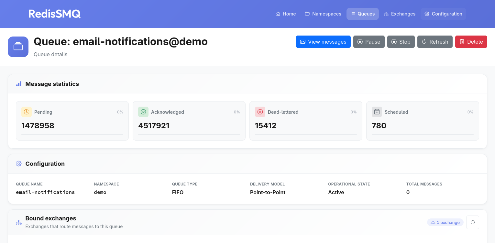

# RedisSMQ Web UI



A browser-based dashboard for [RedisSMQ](https://github.com/weyoss/redis-smq) —
the Redis-backed message queue.

Use it to inspect queues, publish and browse messages, manage exchanges,
and tune runtime configuration, all without touching a command line.

---

## What you can do

- **See the whole system at a glance** — queue, exchange, and namespace
  counts plus quick shortcuts on the Home dashboard.
- **Create and configure queues** — FIFO, LIFO, or priority;
  point-to-point or pub/sub; per-queue rate limiting; consumer groups.
- **Browse and act on messages** by state, open one to see its full
  history, and delete, requeue, or bulk-delete from the list.
- **Publish and purge messages** — with scheduling, TTL, priority, and
  scope options.
- **Manage exchanges** — direct, fanout, topic — bind and unbind queues,
  and preview which queues a routing key would reach.
- **Pause, stop, and resume queues** for maintenance, with a full
  operational history.
- **Group resources into namespaces** and filter by them.
- **View or edit the runtime configuration** and watch the API
  connection from the footer.

---

## Getting started

The UI is served by [**RedisSMQ Web Server**](../redis-smq-web-server/README.md),
which also hosts the REST API for you.

```bash
# Install (Redis client: ioredis or @redis/client)
npm install redis-smq redis-smq-common redis-smq-rest-api \
            redis-smq-web-ui redis-smq-web-server ioredis

# Run — UI at http://localhost:8080/, API at http://localhost:8080/api
npx redis-smq-web-server
```

Common variations:

```bash
# Serve under a sub-path (e.g. behind a reverse proxy)
npx redis-smq-web-server --base-path /redis-smq

# Proxy API calls to an external REST API
npx redis-smq-web-server --api-proxy-target http://127.0.0.1:7210
```

Other flags (`--port`, `--redis-*`, `--log-*`) are documented in
[RedisSMQ Web Server](../redis-smq-web-server/README.md).

---

## Concepts

Six things worth knowing before you start clicking. Everything else is
self-explanatory once these are clear.

### Queue types

| Type     | Behavior                                       |
| -------- | ---------------------------------------------- |
| FIFO     | First in, first out (the default)              |
| LIFO     | Last in, first out                             |
| Priority | Higher-priority messages delivered first (0–7) |

### Delivery models

| Model          | Behavior                                                          |
| -------------- | ----------------------------------------------------------------- |
| Point-to-point | Each message goes to exactly one consumer.                        |
| Pub/sub        | Each message is broadcast to every consumer group; a group picks. |

### Message states — the tabs on the Messages screen

| Tab               | Shows                                        |
| ----------------- | -------------------------------------------- |
| **Published**     | **Every** message — all states combined.     |
| **Scheduled**     | Waiting for its scheduled time or cron fire. |
| **Pending**       | Waiting for a consumer.                      |
| **Dead-lettered** | Failed processing; can be **requeued**.      |
| **Acknowledged**  | Processed successfully; can be **requeued**. |

### Operational states — shown as a banner on the queue page

| State       | What it means                                                              |
| ----------- | -------------------------------------------------------------------------- |
| **Active**  | Normal operation. Consumers receive messages.                              |
| **Paused**  | Messages still arrive, but no consumer gets them. For planned maintenance. |
| **Stopped** | Both production and consumption blocked. Consumers are disconnected.       |
| **Locked**  | Restricted by a server operation; wait for it to release.                  |

### Exchange types

| Type   | Routes to                                                          |
| ------ | ------------------------------------------------------------------ |
| Direct | Queues bound with the **exact** routing key.                       |
| Fanout | Every bound queue (routing key is ignored).                        |
| Topic  | Queues whose binding pattern matches (`*` = one word, `#` = many). |

### Namespaces

A namespace is a folder for related queues and exchanges. If you don't
specify one, `default` is used. Namespaces are created automatically the
first time you add a queue or exchange to them, and removed automatically
once empty.

---

## The interface

Each screen's primary actions are listed up top. Anything that isn't
obvious is called out where it matters.

### Home — your starting point

The dashboard shows aggregate counts at the top (queues, exchanges,
namespaces), a **Recent queues** list for jumping back into a queue
you've been using, and a **Quick actions** grid (Create queue, Set up
exchange, View queues, Documentation).

If nothing exists yet, a **Getting started** card replaces the recent
list, walking you through the four-step flow with a "Create your first
queue" button.

### Queues

Every queue in one list. Each row has **Open** / **View** (both go to the
detail page) and **Delete** (with confirmation — deletes every message in
the queue too).

**Create queue** (top-right) asks for a name, namespace, type, and
delivery model.

### Queue detail

Statistics (pending, acknowledged, dead-lettered, scheduled), configuration,
**Bound exchanges** (with jump links), **Rate limiting**, **Consumer
groups** (pub/sub only), **Active consumers** (auto-refreshed every 15 s),
and the **Operational state history**.

Actions at the top switch with the current state:

- **View messages**, **Refresh**, **Delete** — always available.
- **Pause** and **Stop** — when Active.
- **Resume** — when Paused or Stopped.

### Messages

Five tabs by state (see the Message states table). Each row shows ID,
status, priority, and a body preview. Click a row for the detail; use
the row icons to **Delete** or **Requeue**. Checkboxes reveal bulk
actions.

**Publish** and **Purge** live in the top-right action bar.

On **pub/sub** queues, the Pending tab first asks you to pick a
consumer group.

### Message detail

Six tabs — **Overview** (ID, status, priority, queue, TTL, retry),
**Body** (with **Copy**), **State** (lifecycle timestamps),
**Scheduling** (delay, cron, repeat), **Timeline** (chronological events),
**Unack history** (if the audit feature is enabled) — plus **Requeue**
and **Delete** in the footer.

> **Requeue creates a duplicate.** It produces a **new message** with the
> same body and consume options and publishes it to the original's queue.
> The original is **not** moved — it stays where it was, with its
> **Requeue count** incremented. So after requeuing you have **two**
> messages: the original and the copy. The copy's **Scheduling** tab shows
> a `Requeued parent` link back to the original. Requeue is available for
> **acknowledged** and **dead-lettered** messages; other states return an
> error.

### Publish

Pick a destination (queue or exchange), write a body (JSON or plain
text — JSON validates before submit), optionally set priority, TTL,
consume timeout, and retry settings, and optionally schedule with a
delay **or** a cron pattern (mutually exclusive).

When done you'll see the assigned message ID(s) and can jump straight to
the target queue.

### Purge

Pick a scope — Published (= **all messages**), Pending, Scheduled,
Dead-lettered, or Acknowledged. For "all messages" you must tick an
acknowledgement checkbox (deliberate friction — this is unrecoverable).

A live count shows progress; **Cancel purge** stops the job, but
**closing the dialog does not** — the job runs server-side.

### Exchanges

One card per exchange: type (color-coded), bound-queue count, and up to
three bound queues with their routing keys. **Bind queue** opens the
binding modal; **View details** opens the exchange page.

### Exchange detail

**Bindings** grouped by routing key (direct/topic) or flat (fanout), with
an **×** to unbind. **Match preview** takes a routing key and shows which
queues a message would reach. **Delete** is enabled only when no queues
are bound.

### Namespaces

One card per namespace with counts and links to filtered queues or
exchanges. Deleting a namespace requires it to be **empty** — every queue
message-free with no active consumers, and no exchange with bound queues.

### Configuration

Default namespace, logger (enabled, level, colorization, timestamps), and
three independent message-audit toggles with optional size and expiry
settings.

---

## Common workflows

### First time? Try this flow

1. Open the app. **Home** shows you what already exists.
2. **Create a queue** — the Quick actions grid on Home has a shortcut,
   or use **Create queue** on the Queues screen.
3. **Publish a test message** — from the queue's **Messages** view, click
   **Publish**, paste `{"hello":"world"}`, and click **Publish**.
4. **Find it** — the message appears in **Published** (and **Pending** if
   no consumer is running). Click the row for the detail modal.

That covers the main navigation pattern. Everything else is for particular
tasks.

### Investigate a specific message

Click any row in a Messages list to open its detail modal. Start with
**Timeline** for the sequence of events; **State** for exact timestamps;
**Unack history** (if enabled) for why a failure happened.

### Recover a failed or acknowledged message

Open the message (row or detail modal) → **Requeue** → confirm. A new
message appears in the queue — see the **Requeue** callout under Message
detail for exactly what happens.

### Route messages through an exchange

1. **Exchanges** → **Create exchange**.
2. On its card, click **Bind queue** and pick a queue (routing key or
   pattern for direct / topic).
3. Publish with **Through exchange** selected and provide the routing key.
4. Use **Match preview** on the exchange page to sanity-check which
   queues would receive a given key.

### Pause a queue for maintenance

Open the queue → **Pause** → pick a reason and optional description →
**Pause queue**. The banner stays visible until you **Resume**.

### Clear messages from a queue

**Messages** → **Purge** → leave scope as **Published messages**
(= all messages) → tick the acknowledgement checkbox → **Confirm**.
Watch the progress indicator; **Cancel purge** stops the job mid-run.

---

## Troubleshooting

### "API unreachable" in the footer

The browser can't reach the REST API. Confirm the server is running and
that the URL it's listening on matches what the UI expects. Click the
indicator to re-check without reloading.

### A queue shows "Locked" and I can't pause or resume

The server is running a long operation — a purge, a state transition, or
a background job. Wait for the lock to release.

### "NamespaceNotFoundError" on a bookmarked URL

The namespace no longer exists (its last queue and exchange were deleted).
Use the top navigation to reach a page that still exists.

### A message shows Pending but no consumer picks it up

Check the queue's **Active consumers** card. Zero means no consumer is
running. If consumers are connected but the queue is Paused or Stopped,
**Resume** it.

### My purge deleted more than I expected

The default scope **Published messages** means _every message regardless
of state_, not "pending messages". Choose a narrower scope next time.

### A confirmation dialog keeps failing

| Error                          | Cause                                                      |
| ------------------------------ | ---------------------------------------------------------- |
| `QueueNotEmptyError`           | Queue still has messages. Purge first.                     |
| `QueueHasActiveConsumersError` | A consumer is still connected. Stop your consumer process. |
| `QueueHasBoundExchangesError`  | Queue is still bound to an exchange. Unbind it.            |
| `ExchangeHasBoundQueuesError`  | Exchange still has queues bound. Unbind them.              |
| `ConsumerGroupNotEmptyError`   | Group still has pending messages. Purge them.              |

All surface inline in the confirmation modal.

### Unack history is empty when I expected entries

The **Unacknowledgement history** feature is disabled by default. Enable
it in **Configuration → Message audit**.

---

## Keyboard

- `Tab` from a fresh page lands on the **Skip to main content** link.
- `Escape` closes the currently-open modal.
- `Enter` submits the focused form (or triggers its primary action).
- `Enter` or `Space` on a message row opens its detail modal.

---

## Learn more

- [RedisSMQ documentation](https://github.com/weyoss/redis-smq/tree/master/packages/redis-smq/docs)
- [RedisSMQ REST API](../redis-smq-rest-api/README.md)
- [RedisSMQ Web Server](../redis-smq-web-server/README.md)
- **Version compatibility:** use `@latest` for a stable release or
  `@next` for a development build, and check the
  [compatibility matrix](https://github.com/weyoss/redis-smq-docs#compatibility-matrix)
  to keep packages aligned.

## License

RedisSMQ Web UI is released under the [MIT License](../../LICENSE).
